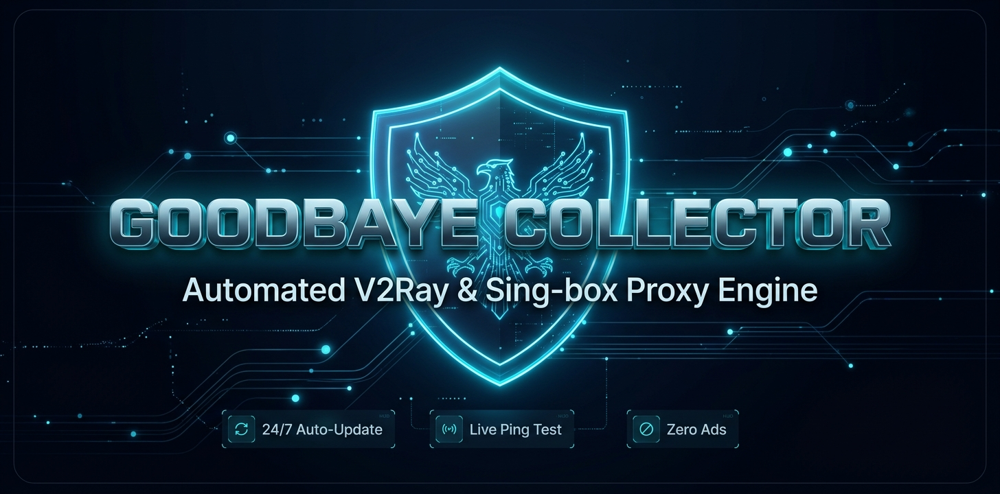

<div align="center">
  

  <br><br>

# 🛡️ Goodbaye Collector
### ابر کالکتور و موتور هوشمند سابسکریپشن V2Ray

[](#)
[](#)
[](https://alireza786786.github.io/Goodbaye_Collector/)
[](https://t.me/Goodbaye_filtering)
[](https://t.me/CONFIG_V2RAY_VIP)

</div>

---

## 🌐 وب‌سایت و پنل اختصاصی اشتراک
برای مشاهده پنل کاربری مدرن، کپی آسان با یک کلیک و دریافت پروکسی‌های زنده تلگرام، وارد آدرس زیر شوید:

👉 **[ورود به پنل آنلاین اشتراک Goodbaye](https://alireza786786.github.io/Goodbaye_Collector/)**

---

## 🚀 معرفی پروژه
این پروژه یک سیستم تمام‌اتوماتیک است که هر ۲ ساعت یک‌بار، بیش از ۵۰ کانال مرجع را اسکن کرده، با استفاده از دیتابیس `GeoLite2-City` کشور و شهر دقیق را استخراج می‌کند، تست پینگ زنده می‌گیرد، سرورهای قطع‌شده و تبلیغات را حذف می‌نماید و خروجی‌ها را طبق **قانون ثابت** منتشر می‌کند.

<br>

### 📦 لینک‌های اصلی سابسکریپشن (آماده کپی در کلاینت‌ها)

**⭐ سابسکرایب اصلی (تست‌شده و فوق‌العاده پایدار):**
```text
https://raw.githubusercontent.com/alireza786786/Goodbaye_Collector/main/Goodbaye_Sub.txt
```

**⚡ سابسکرایب لایت (داغ‌ترین کانفیگ‌های ۲ ساعت اخیر):**
```text
https://raw.githubusercontent.com/alireza786786/Goodbaye_Collector/main/Goodbaye_Light.txt
```

**🇮🇷 پکیج اختصاصی کمترین پینگ برای ایران (بهترین مسیرهای مخابراتی):**
```text
https://raw.githubusercontent.com/alireza786786/Goodbaye_Collector/main/iran_ping_top10.txt
```

**🌍 پکیج اختصاصی اینترنت آزاد جهانی (بالاترین آزادی اینترنت):**
```text
https://raw.githubusercontent.com/alireza786786/Goodbaye_Collector/main/open_internet_top10.txt
```

**🚫 بدون آی‌پی کلودفلر (مخصوص اینترنت‌های حساس و همراه اول):**
```text
https://raw.githubusercontent.com/alireza786786/Goodbaye_Collector/main/Goodbaye_no_cf.txt
```

**🗓️ آرشیو پایدار هفتگی (۷ روزه):**
```text
https://raw.githubusercontent.com/alireza786786/Goodbaye_Collector/main/conf-week.txt
```

<br>

### ⚙️ فرمت مخصوص کلاینت‌های حرفه‌ای

**کلاینت Clash / Mihomo (با قوانین هوشمند دایرکت ایران و هوش مصنوعی):**
```text
https://raw.githubusercontent.com/alireza786786/Goodbaye_Collector/main/Goodbaye_Clash.yaml
```

**کلاینت Sing-box (فرمت باینری و سبک):**
```text
https://raw.githubusercontent.com/alireza786786/Goodbaye_Collector/main/Goodbaye_Singbox.json
```

<br>

### 🌍 سابسکرایب تفکیک‌شده بر اساس کشور

**🇩🇪 آلمان (DE):**
```text
https://raw.githubusercontent.com/alireza786786/Goodbaye_Collector/main/regions/conf-DE.txt
```

**🇳🇱 هلند (NL):**
```text
https://raw.githubusercontent.com/alireza786786/Goodbaye_Collector/main/regions/conf-NL.txt
```

**🇹🇷 ترکیه (TR):**
```text
https://raw.githubusercontent.com/alireza786786/Goodbaye_Collector/main/regions/conf-TR.txt
```

**🇺🇸 آمریکا (US):**
```text
https://raw.githubusercontent.com/alireza786786/Goodbaye_Collector/main/regions/conf-US.txt
```

**🇬🇧 انگلیس (UK):**
```text
https://raw.githubusercontent.com/alireza786786/Goodbaye_Collector/main/regions/conf-UK.txt
```

**🇫🇮 فنلاند (FI):**
```text
https://raw.githubusercontent.com/alireza786786/Goodbaye_Collector/main/regions/conf-FI.txt
```

**🇫🇷 فرانسه (FR):**
```text
https://raw.githubusercontent.com/alireza786786/Goodbaye_Collector/main/regions/conf-FR.txt
```

---

<div align="center">

📢 **کانال اصلی تلگرام:** [@Goodbaye_filtering](https://t.me/Goodbaye_filtering)  
👑 **کانال وی‌آی‌پی:** [@CONFIG_V2RAY_VIP](https://t.me/CONFIG_V2RAY_VIP)

</div>
